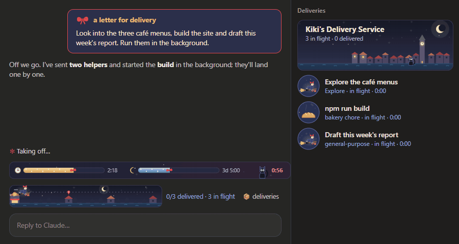
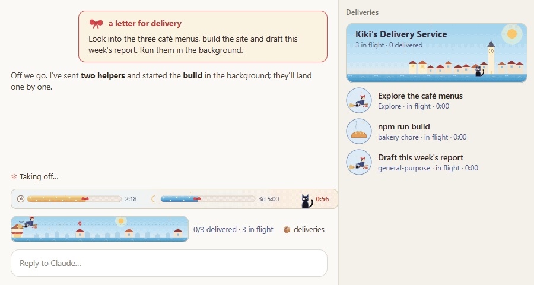

# meadow-sprites · Kiki's Delivery Service for Claude Code

A Claude Code mod that turns the space above your prompt into the seaside town of Koriko, after *Kiki's Delivery Service*. Your usage limits and prompt cache sit in a little sky ribbon. Every subagent or background task is a parcel that Kiki flies to a house along the shore.



By day, when the app is in light mode:



## What you get

**Sky ribbon** (always above the prompt)
- **Usage left:** the 5-hour session limit is a traffic light: green with half or more left, yellow down to 20%, rose red below that. The 7-day limit is a strip of sea blue that turns rose red under 15%. What's left of the strip is what you have left. A clock-style reset time (`2:02`, `3d 5:00`) sits beside it.
- **Prompt cache:** Jiji the cat. While the cache is warm he sits up, blinking and swishing his tail, next to the time until it cools. Now and then he licks a paw. If a strip drops under 20% he walks over on four legs and points at it, three times. Every 10 to 15 minutes Lily, the white cat next door, trots in to play with him for a bit. Once it goes cold he curls up asleep, next to how long it has been and what the next message will cost to re-cache.

**Deliveries band** (while subagents or background tasks run)
- Kiki sets out from the bakery. Each delivery is a house, and a red pin bobs over the one she's heading for.
- She glides toward it while the task runs. When it finishes, the window lights up and she flies on. Seagulls fly along for the other deliveries in flight.
- When every delivery is done, sparkles burst over the last house.

**Delivery board** (`/meadow`, or the 📦 button)
- A row for each task: Kiki on her broom for a subagent, a loaf of bread rising for a background shell command.
- When a task lands, Kiki flies off and the parcel drops in with a bounce and a green stamp. A task you stopped lands early: Kiki's broom set down by the parcel with a moon-blue stamp. A failed one sinks as a rain cloud rolls in.

**Small touches**
- Your messages become letters for delivery: a navy card with Kiki's red bow.
- The spinner speaks in Kiki's day: "Taking off", "Asking Jiji", "Delivering the parcel", "Landing softly".
- The stars blink, the sea drifts, and the clock tower's hand turns.

**Day and night**

On `auto` (the default), Koriko follows the app's light or dark mode. The small button beside the sky ribbon cycles `◐ auto` → `☀ day` → `☾ night`, and the choice is remembered. You can also run `/meadow theme auto|light|dark`.

## Install

You need Claude Code with mod support. The drawings show in the Claude desktop app. A terminal gets a text version with block bars and emoji.

1. Clone the repo anywhere:

   ```bash
   git clone https://github.com/chanziansing/meadow-sprites.git ~/.claude/local-mods/meadow-sprites
   ```

2. Load it in every session by adding the folder to the `env` block of `~/.claude/settings.json`:

   ```json
   {
     "env": {
       "CLAUDE_CODE_PLUGIN_DIRS": "/absolute/path/to/meadow-sprites",
       "CLAUDE_CODE_PLUGIN_DIR_WATCH": "1"
     }
   }
   ```

   `CLAUDE_CODE_PLUGIN_DIR_WATCH` reloads the mod when its files change. To try it once instead, run `claude --plugin-dir /absolute/path/to/meadow-sprites`.

3. Start a new session. `claude --plugin-dir <path> plugin list` should list `meadow-sprites` as loaded.

### Optional: terminal colour theme

[`extras/kiki-theme.json`](extras/kiki-theme.json) is a matching colour theme for Claude Code in a terminal: Kiki's red, Jiji's night blue and warm lamp light. To use it:

1. Copy it to `~/.claude/themes/kiki.json`.
2. Pick **Kiki's Delivery** in `/config` → Theme.

## Commands

| Command | What it does |
| --- | --- |
| `/meadow` | Opens or closes the delivery board |
| `/meadow clear` | Clears delivered parcels from the board |
| `/meadow theme [auto\|light\|dark]` | Picks day or night; with no argument, cycles to the next |

## How it works

All the code is in [`hooks/`](hooks):

| File | What it holds |
| --- | --- |
| `register.tsx` | The hooks and session state: it watches `agent.spawn`, `turn.step`, `turn.complete`, background `Bash` and `TaskStop` calls, and task notifications, and draws `AbovePrompt`, the `Pane`, `UserMessage`, `Spinner` and `TurnDuration` |
| `koriko.ts` | The deliveries band, the board header and each row's picture |
| `sky.ts` | The usage and cache ribbon |
| `characters.ts`, `scenery.ts` | Kiki, Jiji and the parcels; the houses, sea, stars and moon |
| `palette.ts` | Colours, the day palette and small shared helpers |
| `words.ts` | Kiki's words for the spinner |

Everything is drawn as SVG strings in code, with SMIL animation for the motion. There are no image files and no scripts in the drawings. The day look is a CSS class overlay inside each drawing: under `auto` it's wrapped in `@media (prefers-color-scheme: light)`.

## Privacy and security

- **Nothing leaves your machine.** The mod makes no network requests and has no runtime dependencies.
- **What it reads:** your usage limits, the context size and model name, and the names of tasks as Claude Code reports them. All of it is used only to draw.
- **What it stores:** only your day/night choice (`look`), in the mod's own store. Everything else lives in memory for the session.
- **What it changes:** nothing. It never edits files and never blocks or rewrites tool calls. Its hooks only watch, and add pictures and words.
- **Cost estimates** for re-caching use rough built-in prices and are approximate.

## Development

`claude plugin validate` and `claude plugin test` need nothing else. To type-check, you also need Claude Code's mod API typings in `.claude-plugin/types/`. They aren't checked in: copy that folder from a mod Claude Code scaffolded (`claude plugin init --with hooks`).

```bash
# type-check (TypeScript 5.9 or newer)
npx -y -p typescript@5.9.2 tsc -p .
# check the manifest and hooks, and run the tests
claude plugin validate .
claude plugin test .
```

The GIFs above were recorded from [`docs/demo/demo.html`](docs/demo/demo.html), a mock Claude window driven by the real drawing code. See [`docs/demo/README.md`](docs/demo/README.md) to record them again.

## Credits

This is a fan-made tribute, not affiliated with or endorsed by Studio Ghibli. *Kiki's Delivery Service*, Kiki, Jiji and Koriko belong to their creators. Every drawing here is original SVG written in code; no artwork from the film is used.

Licensed under [MIT](LICENSE).
